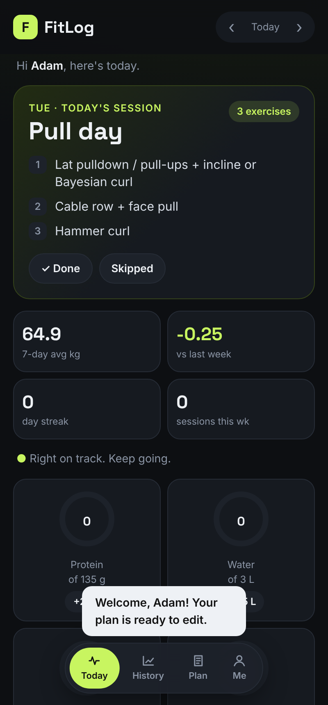
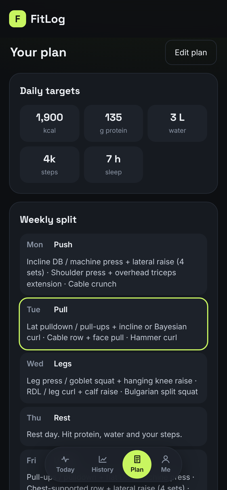
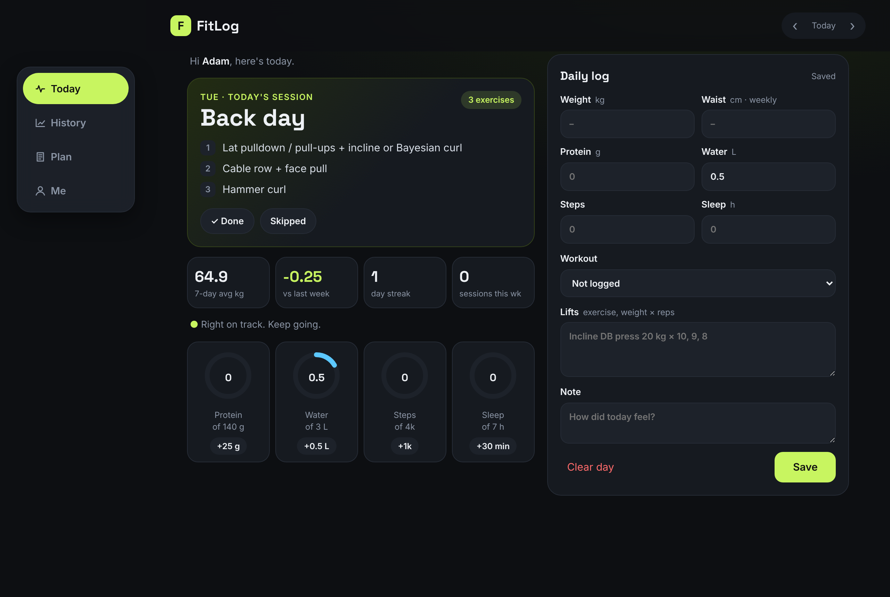

# FitLog

A fitness tracker web app with accounts. It works on phones (installable like a normal app) and
on computers, and each person gets their own private log and their own editable plan.

- **Today**: today's workout from your split, 7-day average weight, weekly change, streak,
  progress rings for protein / water / steps / sleep with one-tap "+" buttons, and the daily log
  (weight, waist, lifts, notes). It saves by itself as you type.
- **History**: weight chart (daily dots + 7-day average line) and every logged day.
- **Plan**: your targets, weekly split and menu. Tap **Edit plan** to change any of it.
- **Me**: profile, install instructions, backup / restore, log out, delete account.
- **Accounts**: sign up with email + password. An optional invite code keeps sign-ups closed
  until you publish.
- **Installable (PWA)**: Android, iPhone, Windows, Mac. Opens even with no internet.

| Phone | Plan | Computer |
|---|---|---|
|  |  |  |

---

## 1. How it is built (and why)

```
Phone app / browser
   │   HTML + CSS + JavaScript   (src/app/static)      ← what you see; sw.js + manifest.json make it installable
   ▼
Python API (FastAPI)              (src/app/main.py)    ← the logic: accounts, save, load, weekly trend
   │   auth.py                                         ← password hashing + signed log-in tokens
   ▼
Database                          (src/app/storage.py)
   • on your laptop: SQLite file  (data/fitness.db)
   • in the cloud:   AWS DynamoDB tables fitlog-users + fitlog-days
```

**One main stack: HTML/CSS/JS + Python + AWS.** Python is the most common language in cloud
work (automation, AWS Lambda, scripts, DevOps tools), so practising it here pays off twice.

**What about the other languages?**
- **HTML** – used. It is the page itself (with CSS for looks and JavaScript for clicks).
- **Java / C#** – both are great for big company backends (Spring Boot, ASP.NET), but they would
  do the same job as the Python API. Doing the app twice adds no new skill. A good later exercise:
  rewrite `main.py` in C# (ASP.NET Minimal API) or Java (Spring Boot) and deploy it to the same
  AWS setup, so you can say "I built the same API in two languages."
- **C** – not used for web apps. Keep it for university / understanding how memory works.

## 2. Accounts and where records live

- Each account is one row in `users` (email, name, hashed password, their plan settings).
- Each day is one record keyed by **user + date** (`2026-10-12`):
  `weight, steps, water, protein, sleep, workout, waist, lifts, note`.
  Every API call checks the log-in token first, so a user can only ever read and write their own rows.
- Locally everything goes into `data/fitness.db` (one SQLite file, nothing to install).
  In the cloud it goes into DynamoDB. The app picks automatically: if `TABLE_NAME` is set it uses DynamoDB.
- Records saved by the old single-user version are given to the **first account** that signs up.

**Settings (environment variables):**

| Name | What it does |
|---|---|
| `SECRET_KEY` | Signs log-in tokens. Locally one is made for you in `data/secret.key`. |
| `SIGNUP_CODE` | If set, people need this invite code to create an account. Empty = open sign-up. |
| `TABLE_NAME`, `USERS_TABLE` | DynamoDB tables (set by `template.yaml` in the cloud). |

## 3. Run it on your laptop

> New to all this? Follow **[docs/STEP_BY_STEP.md](docs/STEP_BY_STEP.md)**: it explains where your data
> lives, whether it's private, how AWS stays at $0, and every click from install to deploy.

You need **Python 3.13** (python.org). Then, in a terminal inside the `fitness-app` folder:

```bash
python -m venv .venv
# Windows:  .venv\Scripts\activate        Mac/Linux:  source .venv/bin/activate
pip install -r requirements-dev.txt
cd src
uvicorn app.main:app --reload
```

Open **http://127.0.0.1:8000**. The API's own docs page is at **http://127.0.0.1:8000/docs**
(you can try every endpoint from there; good way to learn what an API is).

Run the tests (from the `fitness-app` folder): `python -m pytest`

## 4. Put it on GitHub

1. Make a free account at github.com and install **Git** (git-scm.com) or **GitHub Desktop**.
2. Create an empty repository called `fitlog` (no README, since we have one).
3. In the `fitness-app` folder:

```bash
git init
git add .
git commit -m "FitLog first version"
git branch -M main
git remote add origin https://github.com/<your-username>/fitlog.git
git push -u origin main
```

`.gitignore` already keeps your database file and other junk out of GitHub.
If you link GitHub to Claude later, I can work in the repo directly.

## 5. Deploy it to AWS (free tier)

**What gets created** (all written in `template.yaml`, so the whole setup is code: this is called
*Infrastructure as Code*, a core cloud skill):

| Piece | AWS service | Cost |
|---|---|---|
| Python API + web page | **Lambda** with a public Function URL | Always free up to 1 million requests/month |
| Database | **DynamoDB** table (2 read / 2 write units) | Always free up to 25 GB and 25 units |
| Bill alarm | **AWS Budgets**, emails you above 0.50 USD | First budgets are free |

One person logging a day uses a tiny fraction of that. New accounts also get starting credits;
check aws.amazon.com/free when you sign up, since AWS changes the terms sometimes.

**Steps (one time, short version; the detailed one is in docs/STEP_BY_STEP.md):**

1. Create an AWS account. Pick region **Asia Pacific (Singapore) ap-southeast-1** (closest to you).
2. Turn on MFA for the root user. Then create an IAM user for yourself and stop using root. (Security is the first thing cloud interviews ask about.)
3. Install the **AWS CLI** (2.32+) and the **AWS SAM CLI**, then sign in with `aws login` (see the guide, Part 4).
4. From the `fitness-app` folder:

```bash
sam build
sam deploy --guided
```

   - Stack name: `fitlog`  · Region: `ap-southeast-1`
   - `SecretKey`: long random text, make it with `python -c "import secrets; print(secrets.token_hex(32))"`
     and keep it (same key every deploy, or everyone is logged out)
   - `SignupCode`: an invite code while you're testing; empty when you publish
   - `AlertEmail`: your email (confirm the email AWS sends you)
   - Answer **y** to "FitLogFunction Function Url has no authentication. Is this okay?"
     (the app has its own log-in), and **y** to save the settings.

5. At the end SAM prints **AppUrl**. Open it, create your account, then install it
   (Me tab shows how for Android, iPhone and computer).

**Update after changing code:** `sam build && sam deploy`
**Delete everything:** `sam delete` (removes the database too, so export first if you need it).

**If `sam build` complains about the Python version**, install Python 3.13 or run
`sam build --use-container` (needs Docker Desktop).
**If the URL shows "Forbidden"**, open the Lambda console → `fitlog` → Configuration →
Function URL, and check the auth type is NONE; the console offers to add missing permissions.

## 6. API cheat sheet

Every path except sign-up, log-in and `/api/config` needs the header `Authorization: Bearer <token>`.


| Method | Path | What it does |
|---|---|---|
| POST | `/api/auth/signup`, `/api/auth/login` | Create account / log in, returns a token |
| GET / PUT | `/api/me` | Your profile and plan settings |
| POST | `/api/me/delete` | Delete your account and all records (needs password) |
| GET | `/api/summary?day=2026-10-12` | Everything the Today screen needs |
| GET | `/api/days?start=2026-10-01&end=2026-10-31` | Days in a range |
| GET / PUT / DELETE | `/api/days/2026-10-12` | Read, save, delete one day |
| GET | `/api/plan` | Targets, split, menu, rules |
| GET | `/api/export` | Download every record (backup) |
| POST | `/api/import` | Restore records from a backup |

## 7. Before you publish (checklist)

1. You've used it yourself for a while and everything works on your phone and computer.
2. Run `sam deploy --guided --profile fitlog` and leave **SignupCode empty**, so anyone can sign up.
3. Add a short privacy page (what you store: email, name, fitness records; that people can delete
   their account any time from the Me tab).
4. Share the link. People install it from their browser, so it's **free**: no app store needed.
   (App stores cost money: Google Play has a one-time developer fee, Apple charges yearly.
   You can add those later by wrapping this same web app.)
5. Watch the AWS bill alarm. A few hundred users still fit in the free limits.

## 8. Grow it into a cloud portfolio

Do these one at a time; each is a real skill employers look for:

1. **CI/CD** – a GitHub Actions workflow that runs the tests and `sam deploy` on every push.
2. **Managed login** – move accounts to **Amazon Cognito** (adds "forgot password" emails and Google sign-in).
3. **Custom domain + CDN** – put the web page on **S3 + CloudFront** and the API behind it.
4. **Monitoring** – a **CloudWatch** dashboard and an alarm when the API errors.
5. **Scheduled job** – an **EventBridge** rule that runs a Lambda every Sunday to write your
   weekly check-in summary.
6. **Certification** – the app gives you hands-on practice for **AWS Certified Cloud Practitioner**,
   then **Solutions Architect – Associate**.

## Files

```
fitness-app/
├── README.md              this guide
├── template.yaml          AWS setup (Lambda, 2 DynamoDB tables, budget alarm)
├── requirements-dev.txt   libraries for running and testing locally
├── src/
│   ├── requirements.txt   libraries the app needs in the cloud
│   └── app/
│       ├── main.py        the API
│       ├── auth.py        password hashing + log-in tokens
│       ├── storage.py     SQLite (laptop) and DynamoDB (cloud) storage
│       ├── plan.py        the starting plan every new account gets
│       └── static/        index.html, styles.css, app.js, sw.js, manifest.json, icons/
├── tests/test_api.py      automatic tests (13)
├── data/                  your local database file goes here
└── docs/                  STEP_BY_STEP.md guide + screenshots
```
